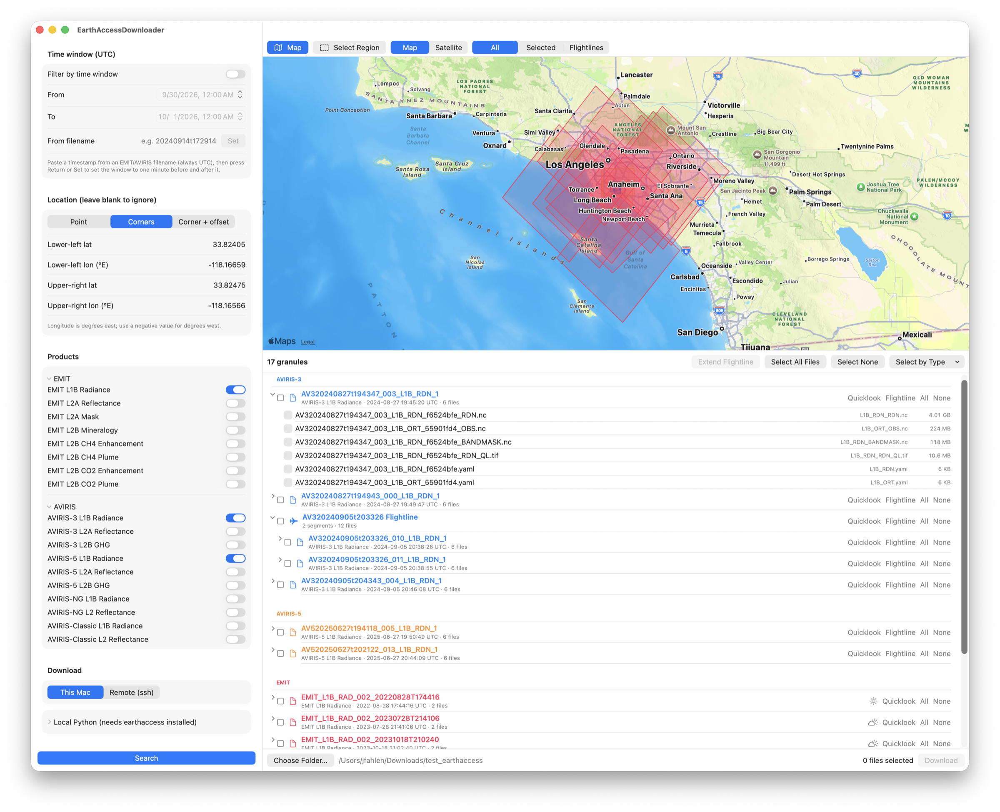

# EarthAccessDownloader

A native macOS app for finding and downloading EMIT and AVIRIS (AVIRIS‑3, AVIRIS‑5, AVIRIS‑NG, AVIRIS‑Classic) imaging spectrometer data from NASA Earthdata. Search by time and place, see the scene footprints on a map, preview quicklook images, and download only the files you want, to your Mac or straight to a remote server. It is built on the [earthaccess](https://github.com/nsidc/earthaccess) Python library.

## Features

### Searching

- Filter by **time window** (UTC date/time pickers), **location**, and **product**. Leave either blank to ignore it.
- Locations can be a **point**, a **bounding box** (lower-left and upper-right corners), or a **corner plus east/north offsets in meters**.
- Paste a timestamp from any EMIT or AVIRIS filename (e.g. `20240914t172914`) to set a one-minute window around it.
- Pick any combination of 18 products: EMIT L1B/L2A/L2B, AVIRIS‑3 and AVIRIS‑5 L1B/L2A/L2B, and AVIRIS‑NG and AVIRIS‑Classic radiance and reflectance.

### Results

- Grouped by instrument and color-coded, with AVIRIS split into its variants.
- Granules from different products describing the **same acquisition** (e.g. EMIT L1B Radiance + L2A Reflectance for one overflight) are combined into one row.
- AVIRIS **flightline segments** are grouped together. One click fetches any segments of the flightline that your search didn't return.
- **Quicklook** button on each row: downloads the scene's browse image to a temporary folder (emptied at launch and quit) and shows it in a sheet. For EMIT it is always the L1B radiance image of the acquisition, whichever EMIT product the row holds.
- **Cloud cover** icon (sun, partly cloudy, cloud) on EMIT rows, with the exact percentage on hover. The catalog has no cloud cover for AVIRIS.
- Per-file checkboxes, with select all / none and select-by-file-type shortcuts.

### Map

Turn on **Map** above the results (it works before any search too).

- **Scene footprints** are drawn from catalog metadata, so nothing extra is downloaded. They use the same instrument colors as the list.
- **Search area:** the point or rectangle you entered is drawn in red and updates as you type.
- **Select Region:** drag a rectangle on the map to fill in the lower-left and upper-right corners. Use it before a first search or to refine the area afterwards.
- **Click a scene** to highlight its row in the list (Cmd-click to add or remove). The list scrolls to it and opens its flightline if needed.
- **Map / Satellite** basemap, and **All / Selected / Flightlines** to draw every result, only the highlighted rows, or every segment of the highlighted rows' flightlines. This helps when many scenes overlap.

Footprints are the catalog's own outlines. EMIT, AVIRIS‑5 and most others are the real rotated swath. For AVIRIS‑3 the catalog stores a north-up box that is larger than the swath inside it.

### Downloading

- Download to a local folder, or to a **remote machine over SSH**, which is handy for pulling data directly onto a server or cluster.

## How it works

The app is a SwiftUI frontend (`EarthAccessDownloader/`) that shells out to a small Python bridge script, `earthaccess_helper.py`, which wraps `earthaccess` for searching, authenticating and downloading. Requests and results are passed as JSON over stdin/stdout, so the Swift side never needs to know anything about the earthaccess API directly.

The map is MapKit. Footprints, browse image links and cloud cover all come from the same catalog records the search returns.

For remote downloads, the same helper script is shipped inline over SSH and run with the remote machine's Python. Nothing needs to be installed on the remote host beyond `earthaccess` itself.

## Requirements

- macOS and Xcode 16+
- Python 3 with [`earthaccess`](https://pypi.org/project/earthaccess/) installed (`pip install earthaccess`), for whichever Python interpreter the app is pointed at
- A [NASA Earthdata](https://urs.earthdata.nasa.gov/) account
- Internet access for the map tiles

## Setup

1. Open `EarthAccessDownloader.xcodeproj` in Xcode and run the app.
2. Under **Local Python** in the sidebar, point the app at a Python interpreter that has `earthaccess` installed (defaults to `python3` on your `PATH`).
3. Authenticate with Earthdata using any method `earthaccess.login()` supports. The most common are:
   - Environment variables: `EARTHDATA_USERNAME` and `EARTHDATA_PASSWORD` (or `EARTHDATA_TOKEN`)
   - A `~/.netrc` entry for `urs.earthdata.nasa.gov`

   The app launches its helper through a login shell, so set these where a *login* shell picks them up (e.g. `~/.zprofile`), not only in an interactive one (e.g. `~/.zshrc`).

Searching needs no login. Downloads and quicklooks do.

## Downloading to a remote machine

To download straight to a remote machine instead of your Mac, set **Download** to **Remote (ssh)** and fill in:

- **Host:** `user@host`, or an alias from your `~/.ssh/config`
- **Folder:** the destination folder on the remote machine
- **Python:** the remote `python3` (or full path) that has `earthaccess` installed

Use **Test Connection** to check it. This requires key- or agent-based SSH auth (no password prompts), and Earthdata credentials available on the remote machine in the same way as above. Quicklooks always download to your Mac.

## License

[MIT](LICENSE) © 2026 Jay Fahlen. This covers the app's code only, not the NASA data it downloads.
